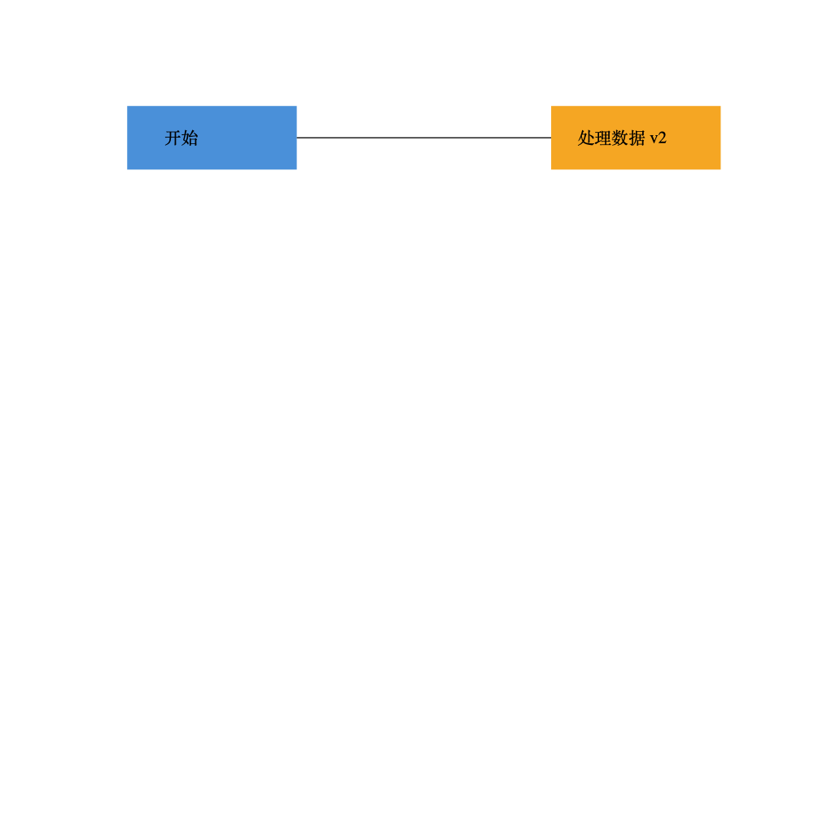

# SVG 编辑器 CLI · Lab1 Phase 1

基于 TypeScript 的面向对象 SVG 命令行编辑器。实现作业全部 Phase 1 命令、六种内置类型、图形树、SVG 文件读写和撤销重做；采用 Command、Composite 和 Memento 模式。

## 快速开始

需要 Node.js 22 或更新版本及 npm。在项目目录执行：

```bash
npm ci
npm run cli
```

出现 `svg>` 后可输入：

```text
init 800 600
create g scene
create rect r1 30 70 120 60 #4a90d9 in scene
create text t1 45 105 "你好，SVG" in scene
move scene 20 0
tree
undo
redo
save demo.svg
```

按 Ctrl-D 退出。把 `demo.svg` 拖入浏览器即可预览。双引号用于带空格的文本或文件名；只把整行以 `#` 开头的内容识别为注释，因此十六进制颜色不受影响。

## 运行、验证和演示

```bash
npm run check      # 严格类型检查 + 自动测试 + 编译
npm run demo       # 回放示例并生成 examples/generated.svg
npm run build
npm start          # 运行编译后的程序
npm run cli -- --script examples/flowchart.commands
```

也支持从标准输入回放：

```bash
npm run cli < examples/flowchart.commands
```

非交互模式不显示提示符；出错后继续处理后续命令，最终以状态码 1 退出。成功信息写 stdout，错误写 stderr。交互会话允许纠错后继续。

## 命令速查

| 类别 | 命令 |
|---|---|
| 文档 | `init [w] [h]`、`read <file.svg>`、`save [file.svg]`、`canvas [w h]` |
| 创建 | `create <type> <id> [params…] [in <containerId>]` |
| 编辑 | `delete <id>`、`move <id> <dx> <dy>`、`scale <id> <factor>`、`set <id> <attr> <value>` |
| 结构 | `group <newGid> <id1> <id2>…`、`ungroup <gid>`、`addto <gid> <id>` |
| 顺序 | `front <id>`（同级最前）、`back <id>`（同级最后） |
| 显示 | `tree [id]`、`show <id>`、`help` |
| 历史 | `undo`、`redo` |

创建参数：

```text
create rect    <id> <x> <y> <w> <h> [fill]
create circle  <id> <cx> <cy> <r> [fill]
create ellipse <id> <cx> <cy> <rx> <ry> [fill]
create line    <id> <x1> <y1> <x2> <y2> [stroke]
create text    <id> <x> <y> "content"
create g       <id>
```

所有创建命令均可在末尾加 `in <containerId>`。`set` 支持公共样式 `fill/stroke/stroke-width`、本类型几何属性、文字的 `text` 内容；不能改 id。`box` 按作业阶段边界报未知类型。



## 提交材料

- [作业文档：架构方案、过程记录、一致性自查、质量保证](doc/README.md)
- [PlantUML 组件图源文件](doc/architecture.puml)
- [两节点流程图命令](examples/flowchart.commands)、[已生成的 SVG](examples/flowchart.svg)
- [原文的外部 SVG 示例](examples/other.svg)
- [提交与答辩说明](doc/SUBMISSION.md)

本地包含分阶段 Git 提交，最终版本以 `final` tag 标记。提交目标仓库：[https://github.com/kangtian2004/Advanced-Software-Development-Technology-lab1](https://github.com/kangtian2004/Advanced-Software-Development-Technology-lab1)。本地 origin 已配置；提交分支为 main，最终标签为 final。用户确认没有额外环境或验收要求，具体截止时间以课程通知为准。
