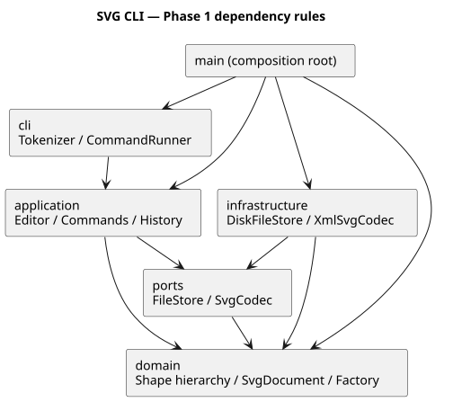
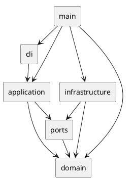

# Lab1 Phase 1：SVG 编辑器（CLI）作业文档

## 架构方案

### 1. 模块划分

| 模块（实际目录） | 职责 | 代表文件 |
|---|---|---|
| `src/domain/` | 图形封装、几何操作、组合树、文档约束、内置图形工厂 | `Shape`、`Rect/Circle/Ellipse/Line/Text/Group`、`SvgDocument`、`ShapeFactory` |
| `src/application/` | 命令对象、编辑事务、撤销重做、用例编排、显示格式 | `Editor`、`EditCommand`、`CommandRegistry`、`TreeFormatter` |
| `src/application/commands/` | 每个 CLI 命令对应一个类，表达用例意图 | `CreateCommand`、`GroupCommand` 等 19 个命令类 |
| `src/ports/` | 对文件存储和 SVG 编解码的抽象边界 | `FileStore`、`SvgCodec` 接口 |
| `src/infrastructure/` | Node.js 磁盘操作、XML 解析与序列化 | `DiskFileStore`、`XmlSvgCodec` |
| `src/cli/` | 分词、执行命令并把异常转成统一错误 | `Tokenizer`、`CommandRunner` |
| `src/main.ts` | 组合根，装配真实依赖、REPL 与脚本入口 | 唯一生产代码启动入口 |
| `test/`、`examples/`、`doc/` | 自动验收、可复现示例、设计和过程记录 | 不被生产模块依赖 |

图形几何属性封装在 `Shape` 内部 Map 中，只能通过校验过的行为方法改变；属性查询返回副本。子类通过 `move` 和 `clone` 多态表达差异。`Group` 私有管理子节点，统一维护父引用并防止循环，避免公共数据袋与按标签反复分派。

组件图的 PlantUML 源码：[architecture.puml](architecture.puml)。





### 2. 设计模式的选择与代码落地

| 模式 | 落地位置 | 解决的问题 |
|---|---|---|
| **Command（必选）** | `Command` 接口、19 个具体命令类、`CommandRegistry` | 分离命令识别、用例执行与交互；编辑命令作为历史对象可撤销、可重做 |
| **Composite** | 抽象 `Shape`、叶子类、`Group` | `move/scale/set/delete` 使用同一接口；容器移动与缩放递归作用于子孙 |
| **Memento** | `EditCommand.before/after`、`SvgDocument.clone()` | 完整还原跨父级分组、删除子树、顺序和样式；每条编辑命令恰好一个历史单元 |
| **Factory** | `ShapeFactory` 与 `ShapeDefinition` | 在单一位置把类型名映射为类，集中创建参数与 SVG 读入规则 |
| **依赖倒置** | `FileStore/SvgCodec` 端口及构造注入 | 应用层无需导入 fs 或 XML 库，测试可替换文件存储 |

一次编辑的实际路径：

1. `Tokenizer` 产生参数；`CommandRegistry` 创建新的具体命令对象。
2. `EditCommand.execute()` 克隆当前文档得到候选文档。
3. 子类 `apply()` 只操作候选文档；所有 id、类型、数值及结构约束在发布前校验。
4. 成功后记录前后快照，`Editor.commitEdit()` 发布候选、追加 undo、清空 redo。
5. 任何一步失败均不发布候选、不改路径、不改历史；由 `CommandRunner` 输出单行 `error:`。

没有给所有命令硬套可撤销接口：文档和显示类命令实现 `Command`；只有编辑类命令继承 `EditCommand`。文档命令成功后清空历史并设置 IO 屏障，下一条成功编辑开启新历史。

### 3. 依赖方向规则

| 模块 | 允许依赖 | 理由 |
|---|---|---|
| domain | domain 内部 | 核心模型独立于交互、磁盘和 XML 实现 |
| ports | domain、ports | 接口需要引用文档类型 |
| application | domain、ports、application 内部 | 用例消费抽象 IO，不认识具体实现 |
| infrastructure | domain、ports、infrastructure 内部、外部库 | 适配器实现端口并把 XML 转换为模型 |
| cli | application、cli 内部 | 交互只负责命令入口和错误输出 |
| main | 各生产模块、Node.js 标准库 | 作为组合根注入具体实现 |

`test/architecture.test.ts` 自动扫描生产代码全部 import（包括 type-only），校验上述规则，禁止其他层依赖 Node.js/XML 第三方库，并检查一类一文件。生产模块无 `switch` 分派。

**允许且待重构的两个按名字分派点**：

- `CommandRegistry.builders`：命令名 → 命令构造器。后续由命令 provider 注册。
- `ShapeFactory.definitions`：图形类型名 → `ShapeDefinition`。CLI 创建与 XML 读入共用同一注册表，后续由 ShapeProvider 注册。

XML 适配器按 XML 节点种类遍历，并以 `instanceof Group` 识别容器能力；几何行为通过多态调用，不再另建按图形标签的分派表。`svg` 根元素检查属于文件格式验证。

### 4. 变化点假设

| 可能变化 | 本阶段决策 | 取舍 |
|---|---|---|
| 新增图形/后续 box 插件 | 工厂集中注册，`Shape` 定义 move/scale/set/clone 等契约；保存 `data-kind` | 尚未实现动态插件加载、schema 插槽、box 属性传播。不能宣称当前已经做到插件新增时内核零改动 |
| 新增 GUI 或 agent 入口 | CLI 与应用层分离，复用命令对象和模型 | tree/show 仍是文本格式；结构化查询视图可在后续提取 |
| 更换文件来源或 XML 实现 | 应用层只依赖端口 | 当前为同步磁盘与同步编解码；网络异步 IO 需要调整端口 |
| 大文档撤销性能 | 使用完整快照保证复杂结构恢复正确 | 每条编辑时间约 O(n)，每个历史单元空间 O(n)，h 条历史为 O(nh)；可改成增量命令或结构共享 |
| 更快的 id 查询 | 当前遍历树查找 id | 牺牲大文档查询速度，避免全局索引与树之间的同步风险；不为课程规模提前维护双份状态 |
| SVG 全规范导入 | 严格支持本阶段子集并保留常见展示属性 | 不支持的节点/属性报错，避免静默丢失图形；暂不实现 path、CSS、资源引用等 |

## 过程记录

以下只记录本次实际 AI 辅助开发；没有把 AI 自己的检查虚构为学生的讨论或审查。学生应在理解、试跑后补充自己的真实意见。

| 阶段 | 实际讨论/发现 | 确认与处理 |
|---|---|---|
| 需求阅读 | 用户先确认是否为作业，随后要求协助完成；原文要求 Command、OOP、分步 Git、文档，并明确排除本阶段 box | 建仓前记录初步方案，逐项划分当前范围与后续目标 |
| 建模 | 只做公共属性袋会违反实现范式；几何与树维护应属于对象行为 | 创建六种具体类；private 状态、clone 多态、Group 维护所有权 |
| 命令与历史 | 单靠反向移动无法可靠恢复跨父级分组、删除与顺序；逐节点修改可能中途失败 | 使用候选文档事务和快照式历史；测试验证溢出发生于第二个节点时，首节点也不能被部分修改 |
| 依赖复查 | XML 适配器需要用工厂读图形；把工厂放在 application 会让基础设施反向依赖用例层 | 在提交应用层之前把 `ShapeFactory/ShapeDefinition` 移至 domain，自动依赖检查确认一致 |
| SVG 导入 | 只按遇到顺序补 id，可能和后面显式 id 冲突 | 先预扫描所有显式 id、拒绝重复，再按标签序号分配；测试嵌套与后置 id |
| 初轮验收 | 首轮 89 项中 88 项通过，剩余测试用 `save round trip.svg`，漏了规范要求的双引号 | 修正测试为 `save "round trip.svg"`；保留程序对多余参数的拒绝；读回与保存内容一致 |
| 扩充验收 | 内存测试不足以证明实际 CLI、文件路径及退出码正确 | 增加真实子进程、临时磁盘读写、250 步混合操作历史参考状态测试；累计 97 项通过 |
| 字符校验审查 | 如果只在保存时校验 XML 字符，编辑阶段可能接收无法保存的文本 | 将校验前移到模型和导入边界，增加原子失败回归用例；累计 99 项通过 |
| 分派复查 | XML 遍历里不应额外依据 text 标签决定行为 | 改为检查模型的文本能力，在工厂之外不增加图形类型名分派 |
| 演示 | 两节点流程图输出 SVG 后用本机 Quick Look 渲染 | 人工检查矩形、文字、连接线位置与中文显示正常，保存示例 |

Git 提交是真实开发阶段记录：先方案，再领域模型、命令事务、XML/CLI、测试、字符校验修复，最后文档和交付验证。用户随后提供 GitHub 目标仓库并确认没有额外要求，另行提交仓库配置说明；没有修改此前开发提交。各阶段都产生独立 commit，并非事后拆分一个完成项目的大提交。未伪造时间、学生身份或远程提交记录；本仓库使用本地 `Codex <codex@openai.com>` 标识 AI 创建的提交。

### 修订记录

- 工厂由最初编码时的 application 位置调整为 domain，最终依赖方向仍符合最初规则。
- 增加 `ShapeDefinition` 描述创建与导入的参数规则；不是公开数据袋。
- 为保留外部样例展示，导入时允许有限的文本展示、transform、透明度与 data-kind 属性；CLI set 白名单未扩大。
- IO 后历史采用“清空 + 屏障”，避免新编辑后撤销跨越保存/读入边界。

## 一致性自查

### 1. 模块划分

实际目录与架构表一致，每个生产类各占同名文件；工厂位置调整已记入修订记录。`main.ts` 只做装配、输入输出，不包含图形几何或分组算法；没有上帝类集中全部职责。

### 2. 依赖方向

自动测试检查全体生产 import，当前无规则违反。抽样：

- `Rect` 只依赖 `Shape`，模型不导入 Editor、fs 或 XML。
- `Editor` 只依赖 `SvgDocument`、端口和应用层命令类型。
- `CreateCommand` 依赖 `ShapeFactory`，不依赖磁盘或 XML。
- `XmlSvgCodec` 依赖 domain/ports 与 XML 库，不反向依赖 application。
- `CommandRunner` 只依赖 application 和本层分词器。
- `Shape` 与 `Group` 的相互类型引用使用 type import，行为通过继承与组合实现。

## 质量保证手段

### 1. 可复现验证

```bash
npm ci
npm run check
npm run demo
node dist/main.js --script examples/flowchart.commands
```

实际开发环境为 Node.js 24.22.0、npm 11.19.1；依赖使用精确版本并提交 lockfile。声明支持 Node.js >=22；本次实测的是 24.22.0，尚未在其他平台逐一验证。

`npm run check` 包含生产与测试的严格 TypeScript 检查、自动测试及编译。当前 **99 个测试全部通过**，无跳过项。交付前还从独立 Git 副本执行 npm ci 和全部检查，编译后的 CLI 回放也成功；原始结果见 [verification.txt](verification.txt)。测试分为 5 个 `.test.ts` 文件及 1 个测试辅助文件：

| 文件 | 验证内容 |
|---|---|
| `editor.test.ts` | 六种类型、几何和样式、递归变换、分组/解组/归属/顺序、撤销分支、错误消息、失败原子性、IO 屏障 |
| `xml.test.ts` | 原文 external SVG、自动补 id 避冲突、SVG 往返、特殊字符、路径默认值、失败 IO、非法及超范围 SVG |
| `cli.test.ts` | 真实 CLI 子进程、stdin/脚本、双引号、中文、#颜色、stderr、退出码、实际磁盘及临时文件清理 |
| `history.test.ts` | 固定种子的 250 步混合命令，检查独立保存的历史状态、唯一 id、父子一致性与 XML 往返 |
| `architecture.test.ts` | 全量 import 依赖规则、禁止 switch、一类一文件 |

### 2. 需求覆盖对照

| 作业要求 | 实现与证据 |
|---|---|
| `init/read/save/canvas` | 各自命令类与 Editor 文档用例；路径、大小、默认值和失败 IO 测试 |
| 六种图形与 `in` | ShapeFactory + 每类型创建/嵌套/撤销测试 |
| `delete/move/scale/set` | 多态模型；叶子与容器测试，白名单与正数校验 |
| `group/ungroup/addto` | 精确顺序和父级恢复；祖先/子孙循环拒绝测试 |
| `front/back` | 仅同级调整；顺序和 undo 测试 |
| `tree/show/help` | 属性内联、父级、子树显示；不进入历史 |
| `undo/redo` | 一条编辑一个单元、新编辑清 redo、IO 成功后屏障 |
| 统一错误与失败不改状态 | 单行 error 前缀；失败命令后对比完整序列化状态并验证 redo 未丢失 |
| SVG 存盘及读回 | XML 转义、嵌套组、viewBox、缺失 id 警告；真实磁盘和 round-trip 测试 |
| Git 和文档 | 分阶段 commit、最终 final tag、本文件与组件图；origin 已配置为用户提供的仓库，推送等待 Git 写入凭据 |

### 3. 边界与限制

- 本项目覆盖课程子集，不是全 SVG 编辑器。不支持 path、polygon、defs、use、CSS style、tspan、DTD 或实体声明；不支持的输入整条 read 失败，不替换当前文档。
- root 支持 width/height/viewBox、有限展示属性；元素支持自身几何属性和常见展示属性。根 SVG 的 id、命名空间声明以及注释不作为图形保存；其他图形的 id 必须存在或自动生成。
- 常见导入展示属性包括 transform、font-size、font-family、font-weight、text-anchor、dominant-baseline、opacity、fill-opacity、stroke-opacity、stroke-linecap、stroke-linejoin、data-kind。它们可以读回保存；CLI set 仍严格限制为作业白名单。
- 导入 transform 原样保留；move/scale 编辑局部几何数值，不求屏幕坐标逆变换。跨父级重组保留局部数值，不保证在不同 transform 或继承样式父级之间视觉位置完全不变。
- 解组传递显式组样式并拼接 transform；复杂透明度叠加的合成效果不保证等价。CLI 创建的普通图形组不受此限制。
- 完整快照历史没有容量上限，适合本实验，不适合无限编辑的大型工程；没有宣称经过性能压力测试或完整 SVG 兼容认证。

## 附录：对规范未明确处的约定

1. `init` 无参数使用 800×600；只给宽度时高度用 600。`canvas` 查询不影响历史，修改时必须同时给宽高。画布尺寸必须为有限正数，图形尺寸允许 0 但不允许负数，坐标可为负数。
2. `help` 在未建文档时也可用；其他需要文档的命令统一报原文规定错误。
3. 分组选择项按原文档深度优先顺序排列；同级分组放在第一个选中节点的位置。跨父级分组挂到最低共同祖先，插在首个被选节点所在直接分支之前；不会凭参数顺序重排。重复成员、选中祖先和其子孙均拒绝。
4. `addto` 移到目标容器末尾；同父级时相当于移到末尾；自身/子孙循环一律拒绝。`front` 放在 sibling 列表末尾，对应 SVG 最后绘制、显示最前；`back` 放列表开头。
5. 顶层 g 按原文禁止 ungroup，即使某些常见编辑器允许，本实现仍遵守作业。
6. IO 失败不设置历史屏障，成功的 init/read/save/canvas 修改清空旧历史并设置屏障；下次编辑解禁后只能撤销新历史，不能跨越屏障。
7. `save <path>` 成功后更新默认路径；以后无参 save 使用最近成功 read/save 的路径。init 清空路径。
8. 省略 fill/stroke 时不生成该属性；组样式使用 SVG 原生继承。scale 只缩放几何坐标和尺寸，不改 stroke-width 或导入的字体大小。
9. `g data-kind="box"` 在本阶段按普通 g 读取，不恢复插件专属行为；`create box` 始终报 unknown shape type。
10. 成功输出表达操作摘要，tree/show 包含必要属性；格式不逐空格复刻示例。撤销/重做输出 `undone:`/`redone:` 加原操作摘要；回放错误由 stderr 与非零退出码识别。
